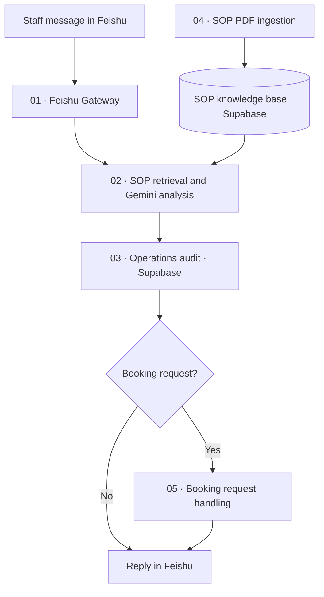
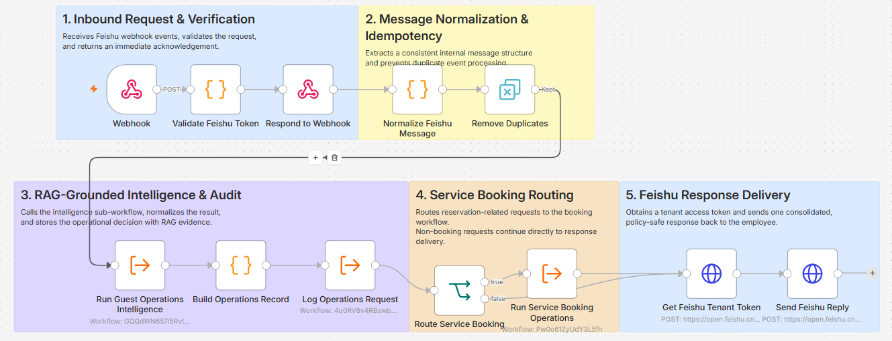
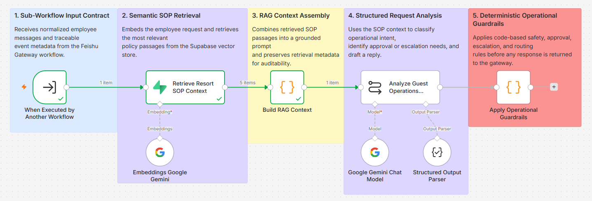
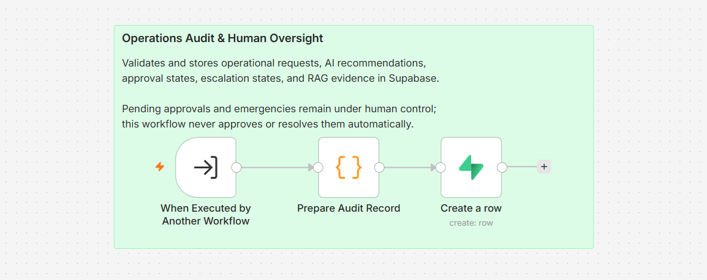
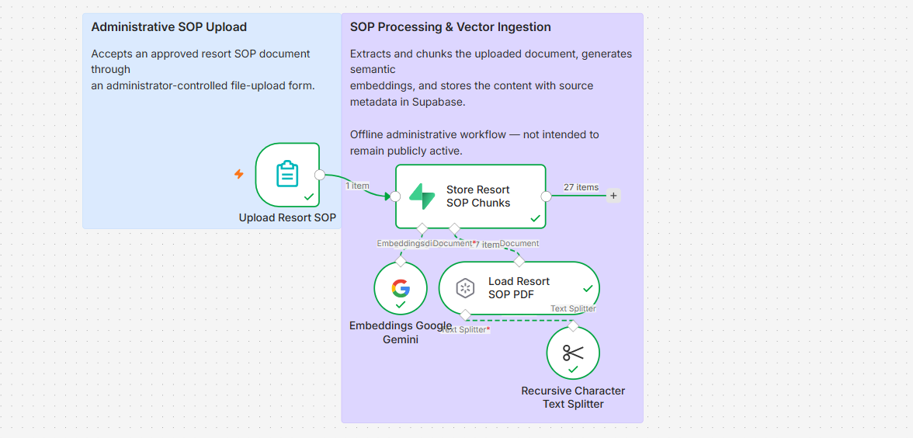
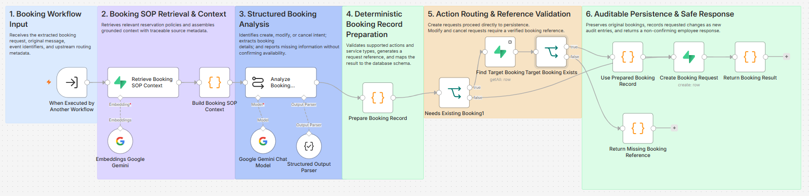

# Resort Guest Operations Copilot

**English** | [简体中文](README.zh-CN.md)

A resort operations assistant built with **n8n, Feishu, Google Gemini and Supabase**. Resort staff use Feishu to report service issues and submit booking requests. The assistant looks up relevant standard operating procedures (SOPs), suggests next steps, flags requests needing approval or urgent attention, and saves the results for staff follow-up.

*Portfolio project using a fictional resort, sample SOPs and synthetic data.*

## Example: handling two requests in one message

A staff member sends:

> “Room 101 has an unusual smell. Could you also arrange breakfast for one guest tomorrow at 7 AM?”

The system identifies the room issue and the breakfast request separately. It retrieves relevant SOP guidance and logs the operational assessment. The booking workflow checks the breakfast details and records the request. Both results are then combined into a Feishu reply.

Other scenarios covered in the project:

| Staff request | System response |
| --- | --- |
| Free late checkout | Records `pending_approval` for manager review. |
| Strong gas smell | Flags the issue for urgent escalation and advises staff to contact the responsible person. |
| SPA request with all required details | Records `pending_availability` for availability checking. |
| Cancellation with an unknown booking reference | Returns `reference_not_found` without creating another request. |

## System architecture

Workflow 01 handles incoming messages, coordinates the other workflows and sends replies. Workflow 04 is run separately when the SOP knowledge base needs updating.

| Workflow | Role |
| --- | --- |
| [01 · Feishu Gateway](workflows/01-feishu-gateway.json) | Receives Feishu events, validates and deduplicates messages, calls sub-workflows and sends replies. |
| [02 · Guest Operations Intelligence](workflows/02-guest-operations-intelligence.json) | Retrieves relevant SOP passages and uses Gemini to analyse requests. |
| [03 · Operations Audit & Approval](workflows/03-operations-audit-and-approval.json) | Saves operational assessments, processing statuses and SOP retrieval details. |
| [04 · Resort SOP Ingestion](workflows/04-resort-sop-ingestion.json) | Processes the SOP PDF and stores its text chunks and embeddings in Supabase. |
| [05 · Service Booking Operations](workflows/05-service-booking-operations.json) | Checks booking details and records requests to create, modify or cancel bookings, linking them to earlier records where needed. |

Workflow diagrams

**01 · Feishu Gateway**

**02 · Guest Operations Intelligence**

**03 · Operations Audit & Approval**

**04 · Resort SOP Ingestion**

**05 · Service Booking Operations**

## Key implementation details

- **SOP retrieval:** The sample PDF is split into text chunks (target size 900, overlap 150). Gemini embeddings and Supabase PostgreSQL/pgvector support retrieval of up to three relevant passages for each request.
- **AI analysis and routing:** Gemini returns structured fields for request type, approval needs, safety escalation and booking intent. JavaScript normalises the output, and Workflow 01 routes booking requests to Workflow 05. This also supports messages that combine service issues with booking requests.
- **Request records:** Supabase stores operational assessments and booking requests. Modification and cancellation requests reference the original record, preserving the request history.

## Testing and current scope

The [test report](docs/test-report.md) documents **11 passing manual integration scenarios** on 17 September 2026. They cover routine services, approval and safety escalation, mixed requests, booking changes and invalid booking references. The [test inputs](tests/scenarios.json) are also available.

The booking workflow records and tracks requests; checking live availability and confirming reservations would require integration with a booking system. Requests needing approval or urgent attention are flagged for staff follow-up. Staff dispatch, approval actions, production monitoring and automatic retries have not been implemented.

Setup and testing

1. Run [`database/schema.sql`](database/schema.sql) in Supabase to create the tables and vector-search function.
2. Import the five JSON files in [`workflows/`](workflows/) into n8n.
3. Configure your own Gemini, Supabase and Feishu credentials. Replace the hard-coded Feishu verification token in Workflow 01 before running or publishing the workflow.
4. Reconnect Workflow 01 to the Workflow 02, 03 and 05 sub-workflows.
5. Upload the [sample SOP PDF](knowledge-base/Harborlight_Bay_Resort_Operations_SOP.pdf) through Workflow 04.
6. Configure the Feishu event callback and permissions, activate the workflows, and follow the [test report](docs/test-report.md) to reproduce the scenarios.

