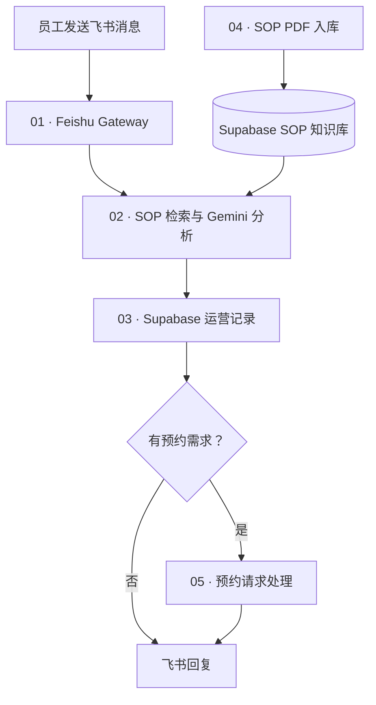
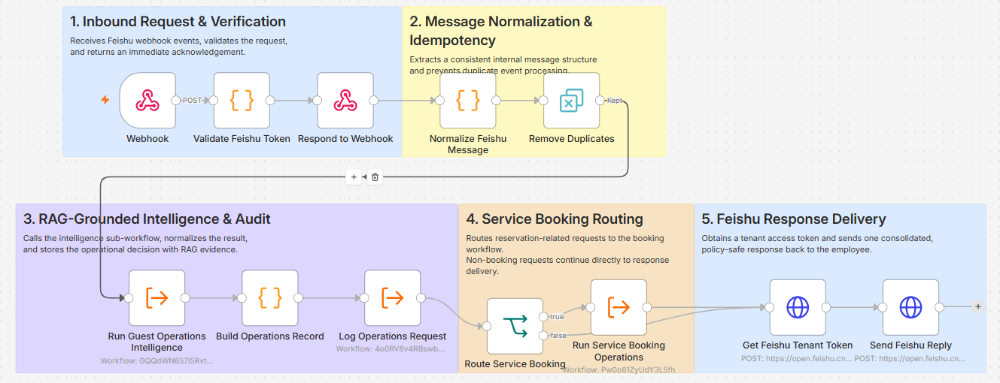
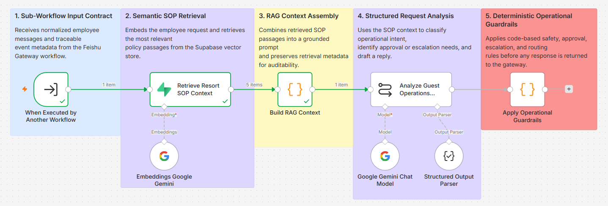
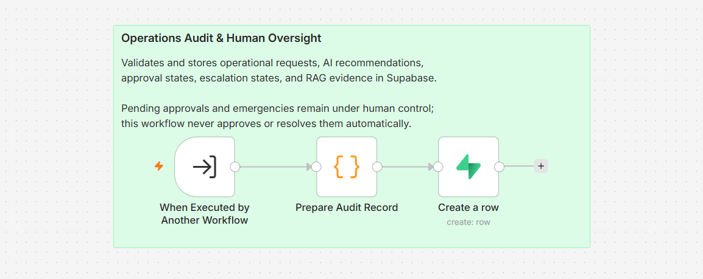
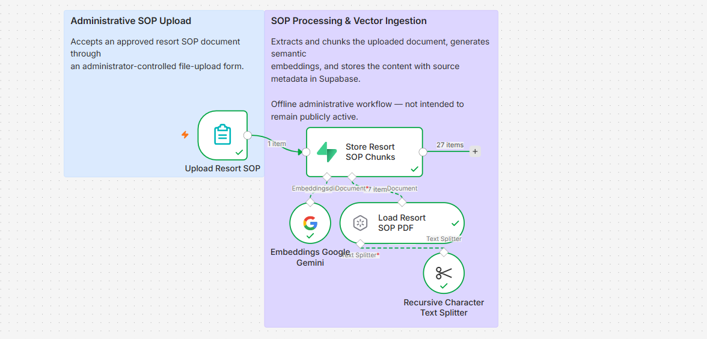
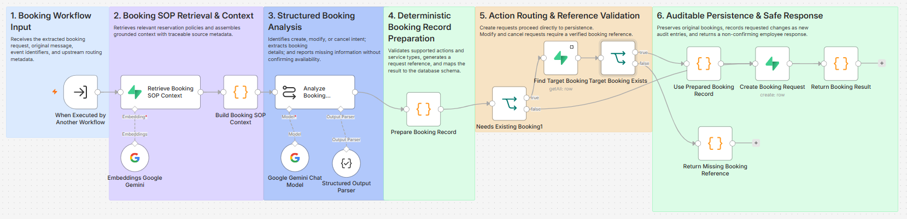

# Resort Guest Operations Copilot｜酒店运营 AI 助手

[English](README.md) | **简体中文**

这是一个面向度假酒店员工的运营辅助项目，使用 **n8n、飞书、Google Gemini 和 Supabase** 搭建。员工通过飞书反映客房服务问题或提出预约需求，系统检索相关酒店 SOP，生成处理建议，识别需要主管审批或紧急跟进的事项，并保存请求和处理状态，方便工作人员后续处理。

*个人作品集项目。酒店、SOP 和业务数据均为模拟内容。*

## 使用示例

例如，员工在飞书发送：

> “101 房间有异味需要处理，另外帮一位客人预约明天早上 7 点的早餐。”

系统分别识别客房问题和早餐预约需求。系统参考相关 SOP 为客房问题生成处理建议，并记录分析结果；预约工作流检查早餐预约信息并登记请求。最后，两部分结果合并回复到飞书。

项目还覆盖以下场景：

| 员工请求 | 处理结果 |
| --- | --- |
| 申请免费延迟退房 | 记录为 `pending_approval`，等待主管审批。 |
| 厨房出现强烈燃气味 | 标记为紧急事项，提醒员工联系负责人。 |
| 提交信息完整的 SPA 预约 | 登记预约请求，状态为 `pending_availability`。 |
| 取消一个不存在的预约编号 | 返回 `reference_not_found`，不新增请求记录。 |

## 系统设计

Workflow 01 负责接收消息、调用其他工作流和发送回复。Workflow 04 在上传 SOP 文档时运行，与日常消息处理分开。

| 工作流 | 主要功能 |
| --- | --- |
| [01 · Feishu Gateway](workflows/01-feishu-gateway.json) | 接收飞书消息，完成校验、去重、子工作流调用和回复。 |
| [02 · Guest Operations Intelligence](workflows/02-guest-operations-intelligence.json) | 检索相关 SOP，使用 Gemini 分析员工请求并生成建议。 |
| [03 · Operations Audit & Approval](workflows/03-operations-audit-and-approval.json) | 保存运营分析结果、处理状态及 SOP 检索信息。 |
| [04 · Resort SOP Ingestion](workflows/04-resort-sop-ingestion.json) | 处理 SOP PDF，将文本分块和向量写入 Supabase。 |
| [05 · Service Booking Operations](workflows/05-service-booking-operations.json) | 检查预约信息，登记新建、修改及取消请求，并关联原有记录。 |

工作流截图

**01 · Feishu Gateway**

**02 · Guest Operations Intelligence**

**03 · Operations Audit & Approval**

**04 · Resort SOP Ingestion**

**05 · Service Booking Operations**

## 技术实现

- **SOP 检索：** 将示例 PDF 的文本分块（目标长度 900、重叠 150），通过 Gemini Embeddings 生成向量并存入 Supabase PostgreSQL/pgvector。处理员工请求时，最多检索 3 段相关 SOP 内容。
- **业务分析与分流：** Gemini 输出业务类别、审批需求、紧急风险和预约意图等结构化字段；JavaScript 整理这些结果，Workflow 01 据此调用预约工作流。同一条消息中的运营问题和预约需求可以分别处理。
- **请求记录：** Supabase 分别保存运营分析记录和预约请求。修改或取消预约时，新请求会关联原记录，以便追溯请求历史。

## 测试与功能范围

[测试报告](docs/test-report.md)记录了 **2026 年 9 月 17 日通过的 11 个手工集成测试场景**，包括日常服务、审批与紧急事项、混合需求、预约修改和无效预约编号。仓库还提供了[测试输入](tests/scenarios.json)。

目前已实现预约请求的登记和状态跟踪；实时空余时段查询与预约确认仍需接入实际预约系统。需要审批或紧急处理的事项会标记出来，交由工作人员跟进。实际审批、人员派单、生产环境监控和自动重试暂未实现。

部署与测试步骤

1. 在 Supabase 中执行 [`database/schema.sql`](database/schema.sql)，创建数据表和向量检索函数。
2. 将 [`workflows/`](workflows/) 中的五份 JSON 导入 n8n。
3. 配置自己的 Gemini、Supabase 和飞书凭据。运行或公开 Workflow 01 前，需要替换代码中硬编码的飞书 Verification Token。
4. 在 Workflow 01 中重新关联 Workflow 02、03 和 05。
5. 通过 Workflow 04 上传[示例 SOP PDF](knowledge-base/Harborlight_Bay_Resort_Operations_SOP.pdf)。
6. 配置飞书事件回调和权限，启用相关工作流，按照[测试报告](docs/test-report.md)验证。

